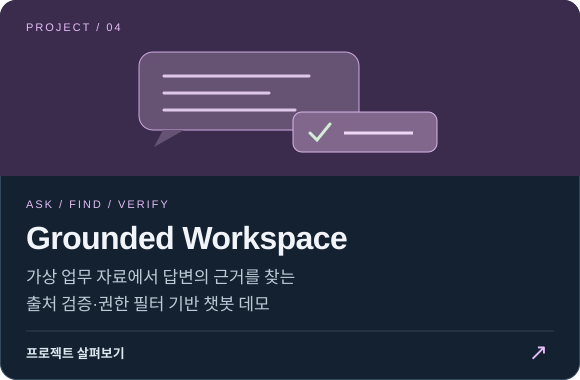
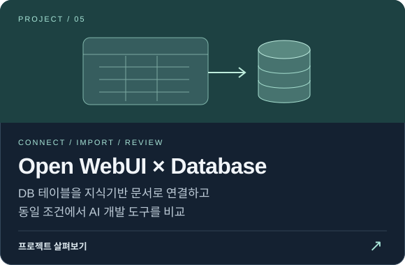
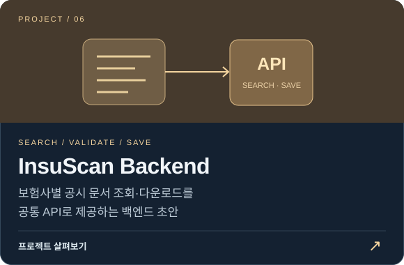
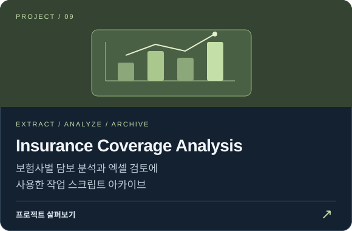
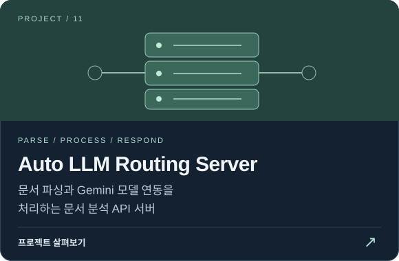

<a href="#project-gallery">Projects</a> &nbsp; / &nbsp; <a href="https://github.com/JeongGyu11?tab=repositories">All repositories</a> &nbsp; / &nbsp; <a href="mailto:sea021118@naver.com">Contact</a>

### A little about me

### Project gallery

직접 만들고 실험한 11개의 공개 프로젝트입니다. 카드를 누르면 각 저장소로 이동합니다.

  
  

  
  

  
  

  
  

  
  

  
  

<a href="https://github.com/JeongGyu11?tab=repositories">전체 저장소 둘러보기 →</a>

Curiosity becomes ideas. Ideas become things.

