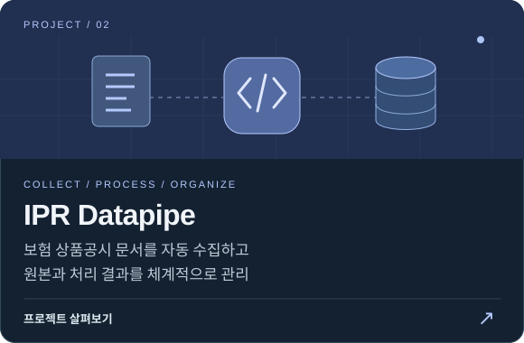

<a href="#selected-work">Projects</a> &nbsp; / &nbsp; <a href="https://github.com/JeongGyu11?tab=repositories">All repositories</a> &nbsp; / &nbsp; <a href="mailto:sea021118@naver.com">Contact</a>

### A little about me

### Selected work

작은 아이디어를 실제로 구현해본 프로젝트들입니다. 카드를 누르면 자세한 내용을 볼 수 있어요.

  
  

<a href="https://github.com/JeongGyu11?tab=repositories">전체 저장소 둘러보기 →</a>

Curiosity becomes ideas. Ideas become things.

